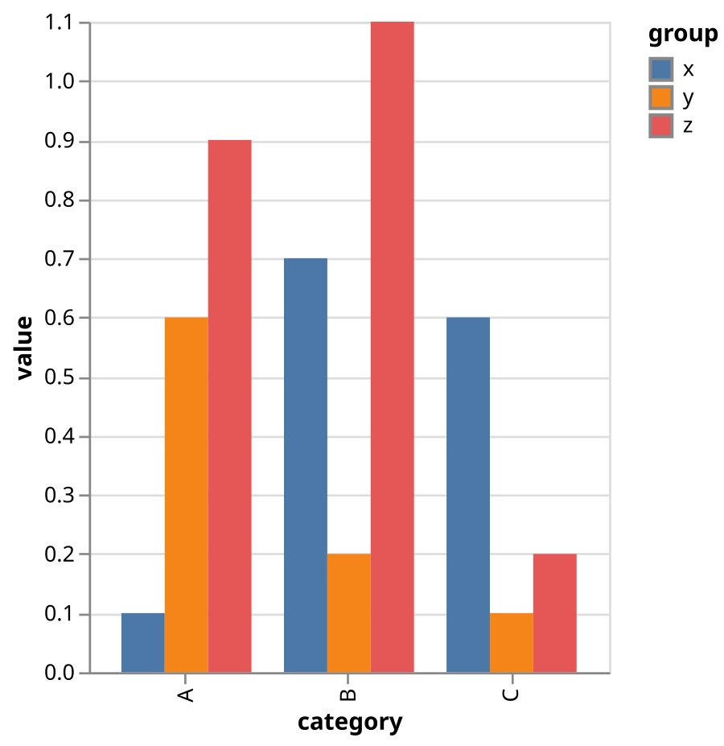
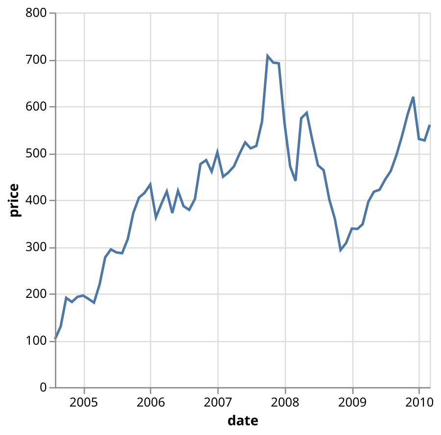
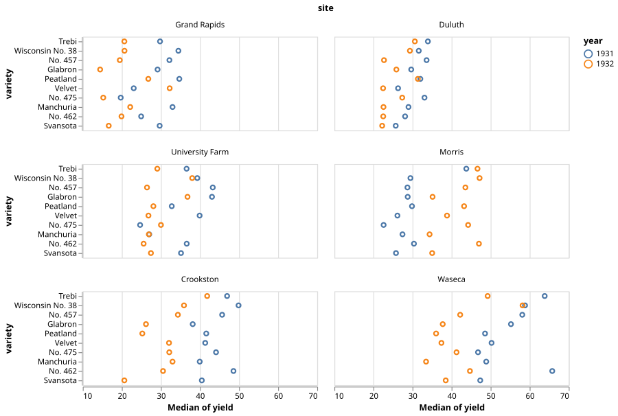
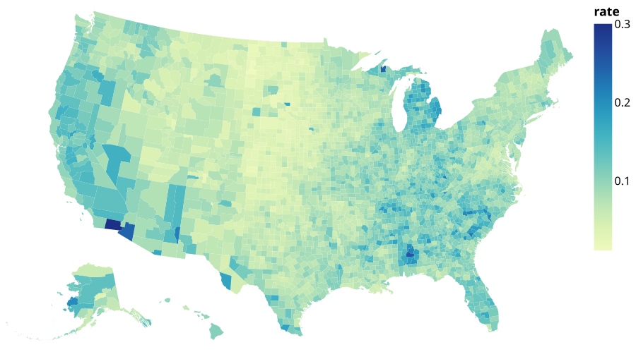

# vega-lite (Rust port)

A Rust port of [Vega-Lite](https://github.com/vega/vega-lite), the grammar of
interactive graphics. It compiles Vega-Lite JSON specifications into Vega JSON
and, through the companion [`vega-svg`](vega-svg/) crate, renders them to SVG
without a Node.js runtime.

The port tracks upstream **v6.5.0** (commit `4a29260c`) and keeps the module
boundaries of the TypeScript sources so the upstream test suite can be
translated module by module.

```rust
use serde_json::json;

let spec = json!({
    "data": {"values": [{"a": "A", "b": 1}, {"a": "B", "b": 3}]},
    "mark": "bar",
    "encoding": {
        "x": {"field": "a", "type": "nominal"},
        "y": {"field": "b", "type": "quantitative"}
    }
});

let compiled = vega_lite::compile(&spec).expect("valid Vega-Lite spec"); // Vega-Lite -> Vega
println!("{}", serde_json::to_string_pretty(&compiled.spec).unwrap());

let svg = vega_svg::vega_lite_to_svg(&spec).expect("render");            // Vega-Lite -> SVG
```

## Examples

Rendered by `vega-svg` from the compiled Vega examples, with no Node.js runtime.

| | |
| --- | --- |
|  |  |
| Grouped bars | Line |
|  |  |
| Faceted trellis | Geo choropleth |

## Usage

### Compile a specification

```rust
use serde_json::Value;

let input: Value = serde_json::from_str(&std::fs::read_to_string("spec.vl.json")?)?;
let result = vega_lite::compile(&input)?;

result.spec;        // compiled Vega specification
result.normalized;  // normalized Vega-Lite specification
```

`vega_lite::compile` is a convenience re-export of
`vega_lite::compile::compile::compile`, matching the top-level `compile()`
export of the npm package.

### Compile and render with `vega-svg`

```rust
use vega_svg::RenderOptions;

let options = RenderOptions {
    data_base: "node_modules/vega-datasets".into(),
    ..Default::default()
};
let svg = vega_svg::vega_lite_to_svg_with_options(&input, &options)?;
std::fs::write("chart.svg", svg)?;
```

See [`vega-svg/README.md`](vega-svg/README.md) for the renderer's supported
subset, CLI and profiling harnesses.

## Benchmarks

Rust vs the upstream TypeScript/JavaScript implementation, same 633 examples,
warm, excluding JSON parsing.

| Workload | vega_rs | Upstream | Speedup |
| --- | --- | --- | --- |
| Compile Vega-Lite to Vega | ~0.88 s (1.4 ms/spec) | ~1.40 s (2.2 ms/spec) | 1.6x |
| Render Vega to SVG | ~5.8 s (9.2 ms/spec) | ~10.5 s (16.5 ms/spec) | 1.8x |

